# Telas e navegação

Esta página mostra o produto para quem não vai rodar o projeto. O site do Cerradinho é uma das aplicações feitas sobre a API, recortada para o campus Gama (FCTE). A API continua servindo a UnB inteira.

- Site: [3-147-228-104.sslip.io](https://3-147-228-104.sslip.io)
- API: `https://api.3-147-228-104.sslip.io/v1`

Os prints são do site em produção em 20/11/2026, numa sexta-feira às 10h, no computador (1440 px) e no celular (390 px).

## Fluxo de navegação

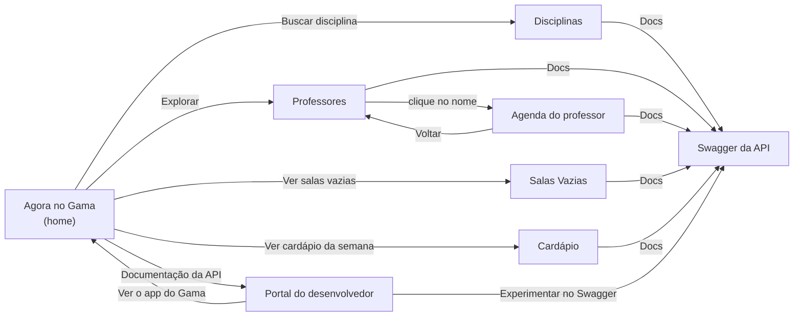

- **Menu fixo.** Os quatro módulos (Disciplinas, Cardápio, Professores e Salas Vazias) e o portal ficam sempre à mão. No computador, ficam numa barra lateral. No celular, ficam numa barra no rodapé, com o portal no botão "API".
- **A home responde o que o aluno procura entre uma aula e outra:** que sala está livre agora, o que tem no RU hoje e onde está uma disciplina. Cada bloco leva ao módulo correspondente. A busca abre Disciplinas já filtrada (`/disciplinas?busca=...`).
- **Professores leva à agenda.** O nome de cada docente abre a grade semanal das turmas dele, com sala e horário.
- **A API aparece em toda tela.** Abaixo do título de cada módulo fica a chamada real que preenche a página (`GET /v1/...`), que muda junto com os filtros, com os botões Copiar, Ver JSON e Docs. Quem quer usar os dados em outro projeto sai dali para o Swagger ou para o portal do desenvolvedor.
- **Cores por módulo.** Cada módulo tem uma cor do cerrado, que aparece na faixa do topo da página e no ícone do menu: verde-buriti em Disciplinas, amarelo-ipê no Cardápio, terra em Professores e caliandra em Salas Vazias. A caliandra também marca o que está acontecendo agora.

## Agora no Gama (home)

Salas livres no bloco de aula de agora, ou no próximo, fora do horário. Mostra também o almoço e o jantar do RU de hoje, a busca de disciplinas, atalhos para os módulos e um bloco que apresenta o Cerradinho como API aberta, com a chamada que preenche as salas livres.

=== "Computador"

    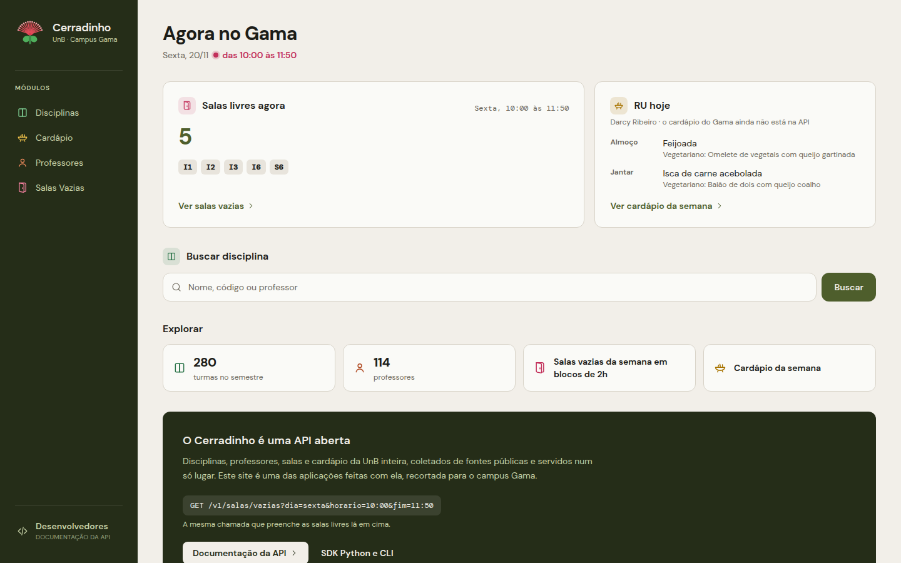

=== "Celular"

    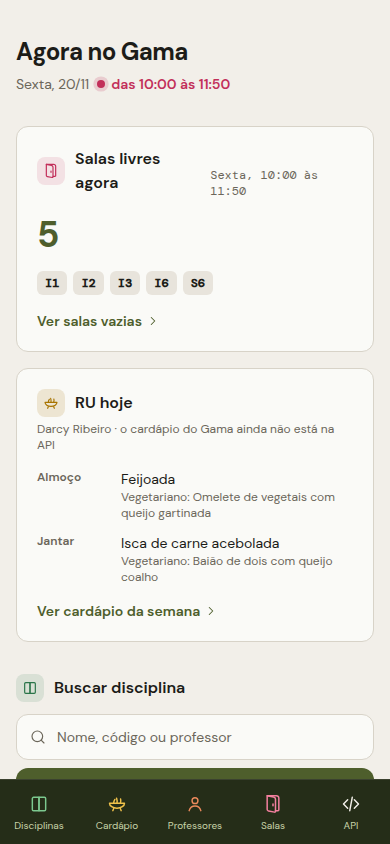{ width="390" }

## Disciplinas

As turmas do semestre com aula no Gama: disciplinas da FCTE e turmas de outros departamentos em sala da FCTE. Dá para buscar por nome, código ou professor e filtrar por departamento, dia e horário. Cada linha mostra a sala e a ocupação das vagas.

Chamada: `GET /v1/disciplinas`

=== "Computador"

    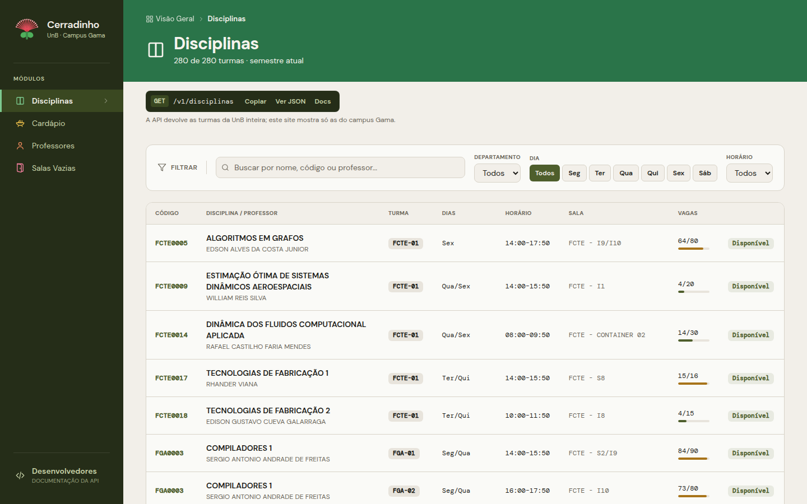

=== "Celular"

    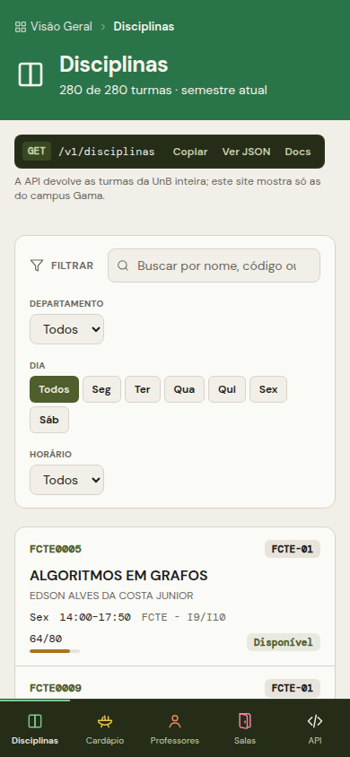{ width="390" }

## Professores

Os docentes que dão aula no Gama, com o departamento e os códigos das disciplinas de cada um. Dá para buscar por nome ou disciplina e filtrar por departamento.

Chamada: `GET /v1/professores`

=== "Computador"

    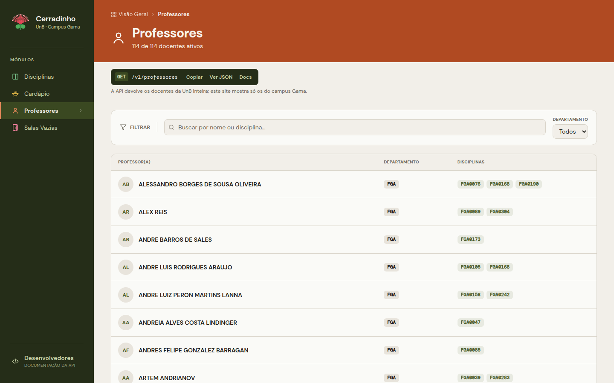

=== "Celular"

    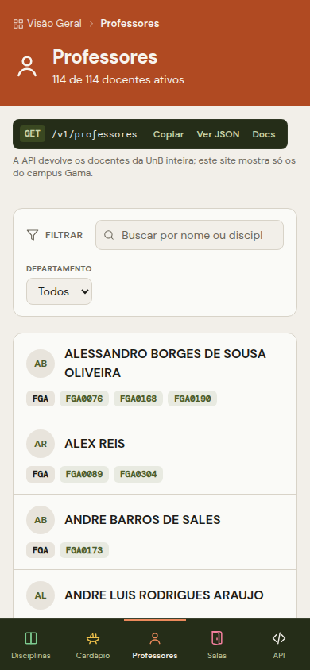{ width="390" }

## Agenda do professor

A grade semanal de um docente, com disciplina, turma, sala e horário de cada aula. No celular, a grade vira uma lista por dia.

Chamada: `GET /v1/professores/{id}/agenda`

=== "Computador"

    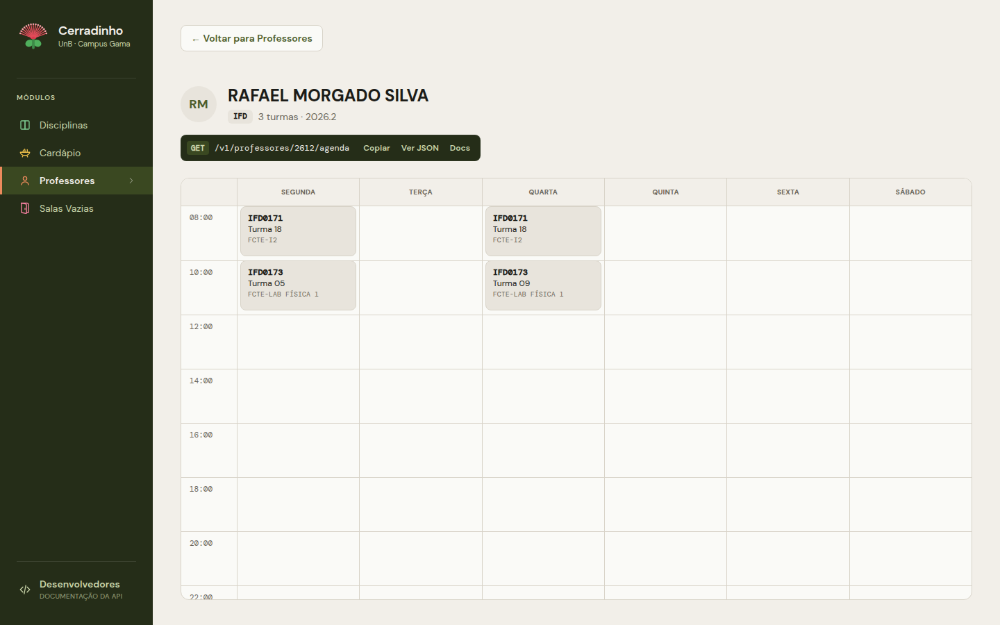

=== "Celular"

    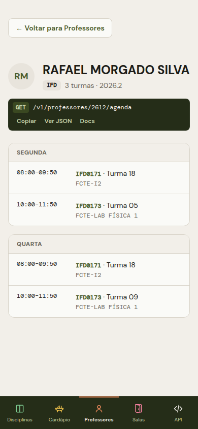{ width="390" }

## Salas Vazias

As salas I1 a I10 e S1 a S10 da FCTE sem aula cadastrada num bloco de duas aulas, de segunda a sábado. O aluno escolhe o bloco (de 8h às 9h50 até 16h às 17h50) e vê os seis dias de uma vez, com o dia de hoje destacado.

Chamada: `GET /v1/salas/vazias?dia=...&horario=...&fim=...`, uma por dia da semana.

=== "Computador"

    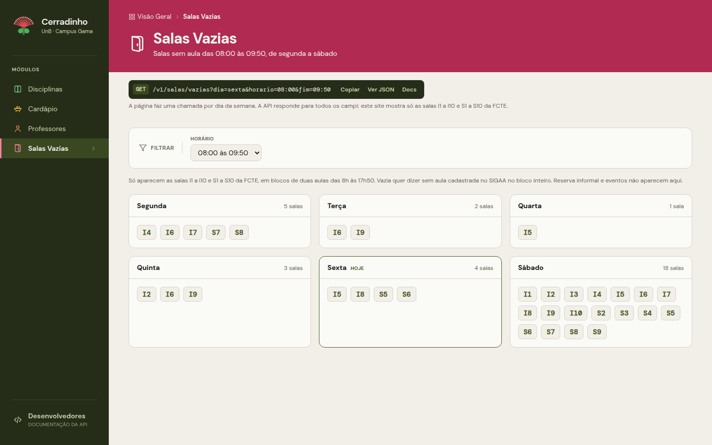

=== "Celular"

    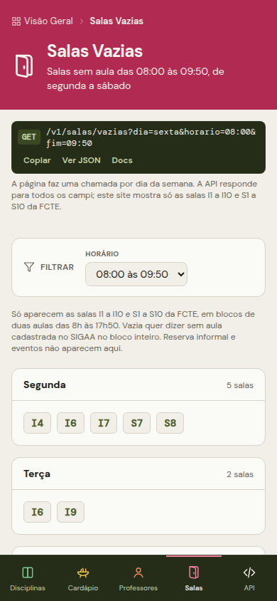{ width="390" }

## Cardápio

O cardápio da semana, com café da manhã, almoço e jantar, aberto no dia de hoje. Dá para navegar entre semanas e filtrar por dia.

Chamada: `GET /v1/cardapio/semana?data_inicio=...`

=== "Computador"

    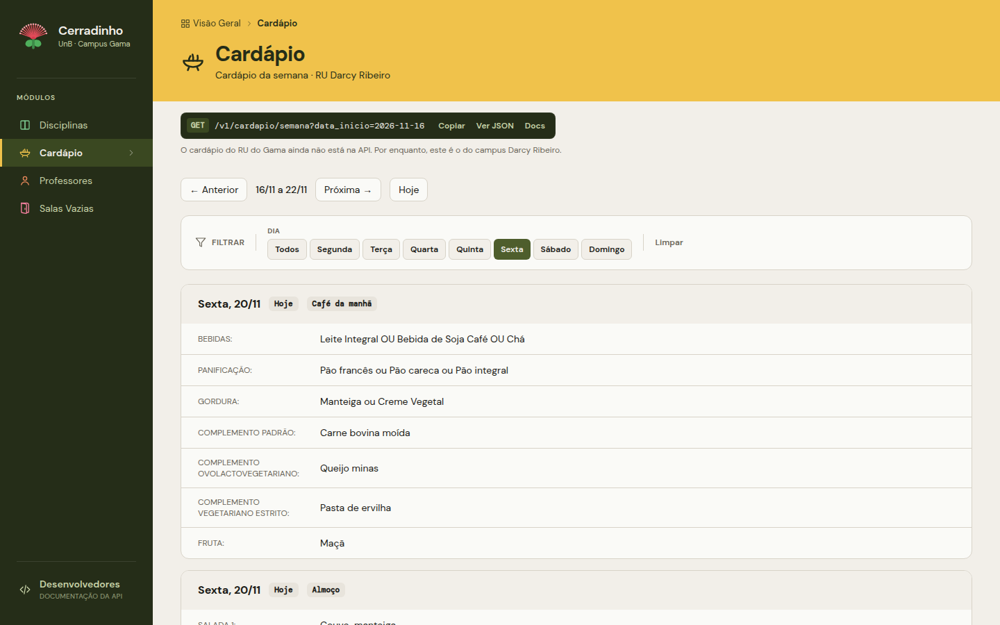

=== "Celular"

    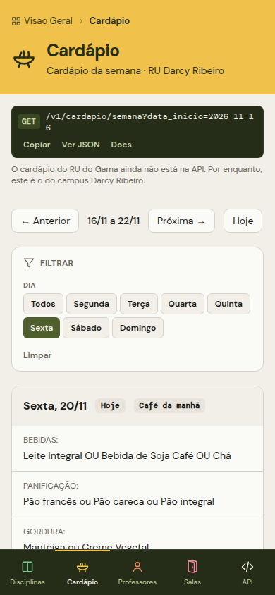{ width="390" }

## Portal do desenvolvedor

A porta de entrada para quem quer usar os dados no próprio projeto. Tem a URL base da API, os totais ao vivo de `/v1/resumo`, a lista de endpoints, exemplos de chamada, o Swagger e a instalação do SDK Python e da CLI.

=== "Computador"

    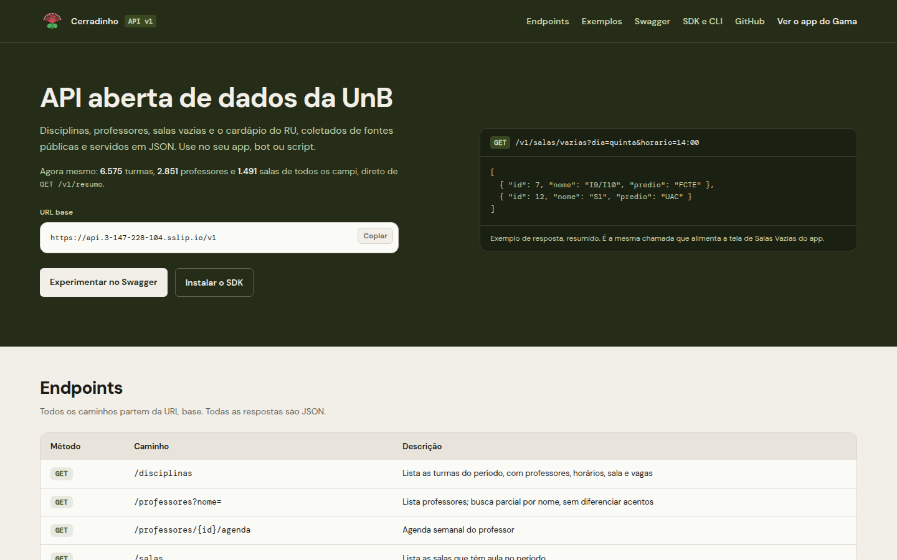

=== "Celular"

    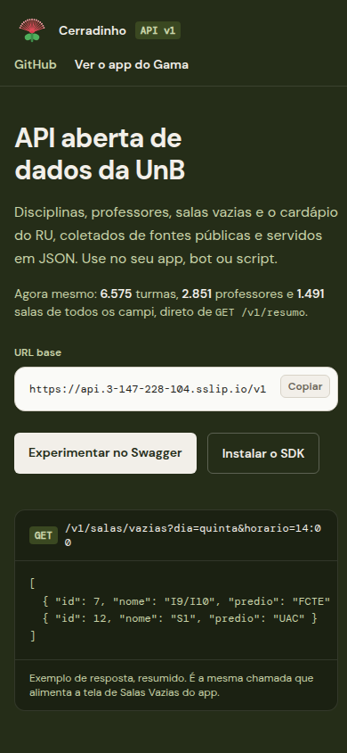{ width="390" }
